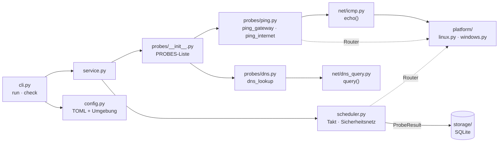

# Architektur (Stand Sprint 1)

> Stand 27.11.2026 · beschreibt den Code unter `src/rootping/` · gehört zu [projektplan.md](projektplan.md)

Diese Seite ist die Landkarte des Codes: welche Module es gibt, wer wen aufruft und wo man etwas ändert. Die Gründe für die großen Entscheidungen stehen in den [ADRs](adr/README.md).

## Überblick

**Lesart:** Pfeile zeigen „ruft auf“. Die Probes geben ihre Ergebnisse an den Scheduler zurück; **nur der Scheduler** schreibt über `storage` in die Datenbank.

## Module

| Modul | Aufgabe | Ändern, wenn … | Doku |
|---|---|---|---|
| `cli.py` | Befehle `rootping run` und `rootping check`, nur Ein- und Ausgabe | ein Befehl dazukommt | [entwicklung.md](entwicklung.md) |
| `config.py` | Konfiguration lesen und prüfen (pydantic-settings) | eine Einstellung dazukommt | [konfiguration.md](konfiguration.md) |
| `service.py` | Baut aus der Konfiguration die Probes und startet den Scheduler | selten | [messdienst.md](messdienst.md) |
| `scheduler.py` | Fester Takt, Fehlerfang, Messlücken, Netzwechsel, Speichern | sich am Ablauf etwas ändert | [messdienst.md](messdienst.md) |
| `probes/base.py` | Schnittstelle `Probe`, `ProbeResult`, `ProbeSettings` | nie ohne ADR | [probes.md](probes.md) |
| `probes/ping.py` | Ping-Runde: 1 Echo pro Sekunde, Zusammenfassung | sich die Ping-Messung ändert | [ping.md](ping.md) |
| `probes/summary.py` | Reine Rechnung: Mittelwert, Maximum, Verlust, Jitter | sich eine Kennzahl ändert | [diagnose.md](diagnose.md#jitter-definition) |
| `probes/dns.py` | DNS-Runde: eine Abfrage pro Server | sich die DNS-Messung ändert | [dns.md](dns.md) |
| `net/icmp.py` | Ein einzelnes Echo, gleich auf beiden Systemen | der Ping-Weg wechselt | [ping.md](ping.md) |
| `net/dns_query.py` | Eine DNS-Abfrage mit fester Fehlerart | sich die Fehlerarten ändern | [dns.md](dns.md) |
| `platform/` | Alles Betriebssystem-Spezifische (Ping, Router, VPN, DNS-Server der Karte) | Windows- oder Linux-Verhalten | [ping.md](ping.md), [netzwerk.md](netzwerk.md) |
| `storage/` | Einziger Datenbankzugriff, Migrationen | sich das Schema ändert | [datenmodell.md](datenmodell.md) |
| `logsetup.py` | Logging in Konsole (stderr) und Datei | selten | – |
| `timeutil.py` | Zeitstempel in UTC und genau einem Format | nie | [datenmodell.md](datenmodell.md) |

## Regeln, die der Code einhält

1. **Messen und Speichern sind getrennt.** Eine Probe kennt keine Datenbank. Dadurch läuft sie unverändert im Labor und ist ohne Datenbank testbar.
2. **Betriebssystem-Unterschiede stecken nur in `platform/`.** Der Rest weiß nicht, ob er unter Windows oder Linux läuft.
3. **Keine fest verdrahteten Werte.** Ziele, Intervalle und Timeouts kommen aus der Konfiguration. Ausnahme mit Begründung: der feste Echo-Abstand von 1 s ([ADR-006](adr/006-ping-ueber-betriebssystem-schnittstellen.md)).
4. **Ein Thread, ein Event-Loop.** Alles läuft in `asyncio`. Einzige Ausnahme: der blockierende Windows-Ping läuft über `asyncio.to_thread`. Deshalb gibt es nie zwei gleichzeitige Schreibzugriffe auf die Datenbank.
5. **Fehler sind Daten.** Ein nicht erreichbares Ziel ist kein Absturz, sondern eine Zeile mit `ok = 0` und einem festen Fehlercode ([datenmodell.md](datenmodell.md#fehlercodes)).
6. **Kein Code ohne Doku.** ruff prüft in der CI, dass jedes Modul und jede öffentliche Funktion einen Docstring hat.
7. **Tests ohne Internet.** Netzwerkaufrufe werden in Tests ersetzt. Echte Pings gehen nur an `127.0.0.1`, echte DNS-Abfragen nur an einen Test-Server auf `127.0.0.1`.

## Sicherheit

| Thema | Umsetzung |
|---|---|
| Rechte | Ping ohne Admin bzw. root ([ping.md](ping.md)); RootPing braucht nie erhöhte Rechte. |
| Unterprozesse | Keine. Ping und Router-Erkennung laufen über Betriebssystem-Schnittstellen. |
| Eingaben | Ping- und DNS-Ziele müssen IPv4-Adressen sein, geprüft beim Start ([ADR-011](adr/011-ping-ziele-nur-ipv4-adressen.md)). |
| Datenbank | Werte nur über Platzhalter (`?`), nie in SQL-Text eingesetzt. Einzige Ausnahme: die Versionsnummer beim Migrieren, eine aus dem Dateinamen geprüfte Zahl. `STRICT`-Tabellen prüfen Typen. Ein Nur-Lesen-Modus für spätere Werkzeuge ist vorhanden. |
| Geheimnisse | Keine im Code oder in der Konfiguration. `config.toml` und `*.db` stehen in `.gitignore`, weil sie echte Netzwerkdaten enthalten. |
| Lieferkette | `uv.lock` mit Hashes, 7 Tage Cooldown, Dependabot mit Cooldown, Actions auf SHA gepinnt, zizmor in der CI. |
