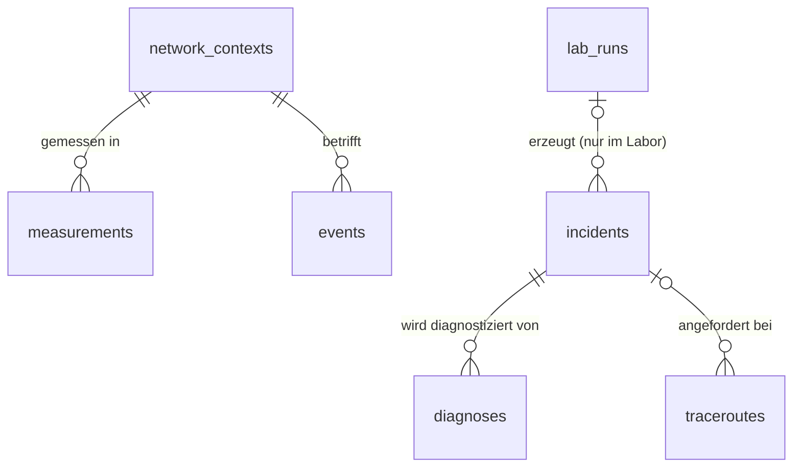

# Datenmodell

> Sprint 0 · Stand 26.11.2026 · gehört zu [projektplan.md](projektplan.md)

RootPing speichert alles in **einer SQLite-Datei**. Dieses Dokument beschreibt, welche Tabellen es gibt, warum sie so aussehen und wie man sie später ändert.

## Getroffene Entscheidungen

| # | Frage | Entscheidung | Warum |
|---|---|---|---|
| 1 | Eine Tabelle für alle Messungen oder eine pro Messart? | **Eine Tabelle** `measurements` mit festen Spalten | Nur drei Messarten; Abfragen bleiben einfach. Nachteil: Bei DNS bleiben `loss_pct` und `jitter_ms` leer. |
| 2 | Jedes Ping-Paket oder nur die Zusammenfassung? | **Zusammenfassung pro Messrunde** (z. B. 5 Pakete → Mittelwert, Verlust, Jitter) | Spart Platz (Faktor 5), reicht für die Diagnose. |
| 3 | Diagnosen von Regeln und KI getrennt? | **Eine Tabelle** `diagnoses` mit Spalte `source` (`rules` / `agent`) | Der Vergleich KI vs. Regeln ist eine einzige SQL-Abfrage. |

Weitere kleinere Festlegungen:
- **Zeitstempel** als Text im Format ISO 8601 in UTC (z. B. `2026-11-26T11:56:00.123Z`). Lesbar, sortierbar, keine Zeitzonen-Verwirrung zwischen Windows und Linux. Umrechnung in Ortszeit erst bei der Anzeige.
- **Feste Wertelisten** (z. B. `probe`, `layer`) stehen als Text in der Datenbank und werden im Python-Code über `Enum` geprüft. So bleibt die Datenbank lesbar, und eine neue Messart braucht keine Schemaänderung.
- **Flexible Details** (Belege, Ereignis-Infos) als JSON-Text. SQLite kann JSON direkt abfragen (`json_extract`).

## Überblick



| Tabelle | Inhalt | Wer schreibt |
|---|---|---|
| `measurements` | Ergebnis jeder Messrunde | Messungen (Probes) |
| `network_contexts` | In welchem Netz wurde gemessen (Gateway, Interface) | Messdienst |
| `events` | Besondere Ereignisse: Messlücke (Ruhezustand), Netzwechsel | Messdienst |
| `incidents` | Erkannte Störungen (Beginn, Ende, Auslöser) | Störungserkennung |
| `diagnoses` | Diagnose zu einem Vorfall, von Regeln oder KI | Regel-Baseline, Agent |
| `lab_runs` | Labor-Durchläufe mit erwarteter Ursache (Ground Truth) | Störungslabor |
| `traceroutes` | Traceroute-Ergebnisse, nur auf Anfrage | CLI, MCP, Agent |

## Tabellen im Detail

### `measurements`

| Spalte | Typ | Beispiel | Bedeutung |
|---|---|---|---|
| `id` | INTEGER PK | 4711 | |
| `ts` | TEXT | `2026-11-26T11:56:00.123Z` | Zeitpunkt der Messrunde (UTC) |
| `probe` | TEXT | `ping_gateway` | Welche Messung (`ping_gateway`, `ping_internet`, `dns_lookup`) |
| `target` | TEXT | `1.1.1.1` | Ziel: Host oder DNS-Server |
| `ok` | INTEGER (0/1) | 1 | Hat die Messung grundsätzlich funktioniert? |
| `latency_ms` | REAL | 12.4 | Ping: mittlere Antwortzeit; DNS: Antwortzeit der Abfrage |
| `loss_pct` | REAL, leer erlaubt | 0.0 | Paketverlust in Prozent (nur Ping) |
| `jitter_ms` | REAL, leer erlaubt | 1.8 | Schwankung der Antwortzeit (nur Ping) |
| `max_ms` | REAL, leer erlaubt | 48.0 | Höchste Antwortzeit in der Runde (nur Ping). Zeigt kurze Lags, die im Mittelwert verschwinden. |
| `error` | TEXT, leer erlaubt | `timeout` | Fehlerart, z. B. `timeout`, `servfail`, `nxdomain`, `unreachable` |
| `context_id` | INTEGER FK | 3 | Verweis auf `network_contexts` |

Index auf `(probe, ts)`, weil fast jede Abfrage lautet: „Werte von Messung X im Zeitraum Y“.

### `network_contexts`

| Spalte | Typ | Beispiel | Bedeutung |
|---|---|---|---|
| `id` | INTEGER PK | 3 | |
| `gateway` | TEXT | `192.168.178.1` | Router-Adresse |
| `interface` | TEXT | `Ethernet` | Netzwerkkarte |
| `first_seen` | TEXT | `2026-11-26T08:00:00Z` | Wann dieser Kontext zum ersten Mal auftrat |

**Warum eine eigene Tabelle?** Gateway und Interface ändern sich selten. Statt sie in jeder Messung zu wiederholen, steht dort nur die Nummer. Ändert sich der Kontext (VPN an, anderes WLAN), entsteht eine neue Zeile und ein Ereignis `network_change`. Die Störungserkennung vergleicht nur Messungen aus demselben Kontext und vermeidet so Fehlalarme.

### `events`

| Spalte | Typ | Beispiel | Bedeutung |
|---|---|---|---|
| `id` | INTEGER PK | 12 | |
| `ts` | TEXT | | Zeitpunkt |
| `type` | TEXT | `gap` | `gap` (Messlücke, z. B. Ruhezustand) oder `network_change` |
| `context_id` | INTEGER FK, leer erlaubt | 3 | Betroffener Netzwerk-Kontext |
| `details` | TEXT (JSON) | `{"gap_seconds": 3600}` | Zusätzliche Infos |

### `incidents`

| Spalte | Typ | Beispiel | Bedeutung |
|---|---|---|---|
| `id` | INTEGER PK | 7 | |
| `start_ts` | TEXT | | Beginn der Störung |
| `end_ts` | TEXT, leer erlaubt | | Ende (leer, solange sie andauert) |
| `trigger` | TEXT (JSON) | `{"probe": "ping_internet", "metric": "loss_pct", "value": 30, "threshold": 5}` | Was die Erkennung ausgelöst hat |
| `context_id` | INTEGER FK | 3 | In welchem Netz |
| `lab_run_id` | INTEGER FK, leer erlaubt | 2 | Nur im Labor: zu welchem Durchlauf gehört der Vorfall |

### `diagnoses`

| Spalte | Typ | Beispiel | Bedeutung |
|---|---|---|---|
| `id` | INTEGER PK | 21 | |
| `incident_id` | INTEGER FK | 7 | Zu welchem Vorfall |
| `source` | TEXT | `agent` | `rules` oder `agent` |
| `layer` | TEXT | `provider` | Hauptursache: `heimnetz`, `provider`, `ziel`, `dns`, `keine_stoerung`, `unklar` |
| `other_layers` | TEXT (JSON), leer erlaubt | `["dns"]` | Weitere gleichzeitige Ursachen (z. B. Szenario „kombiniert“) |
| `cause` | TEXT | „Paketverlust ab dem Provider, Router unauffällig“ | Ursache in einem Satz |
| `confidence` | REAL | 0.8 | Sicherheit 0 bis 1 |
| `evidence` | TEXT (JSON) | `[{"measurement_id": 4711, "note": "30 % Verlust zu 1.1.1.1"}]` | Belege mit Verweis auf Messwerte |
| `recommendation` | TEXT | „Provider-Störung prüfen“ | Empfehlung |
| `model` | TEXT, leer erlaubt | `claude-…` | Nur Agent: verwendetes Modell |
| `tokens_in` / `tokens_out` | INTEGER, leer erlaubt | | Nur Agent: Tokenverbrauch |
| `cost_usd` | REAL, leer erlaubt | 0.004 | Nur Agent: Kosten |
| `duration_ms` | INTEGER | 3200 | Dauer der Diagnose |
| `created_ts` | TEXT | | Zeitpunkt |

### `lab_runs`

| Spalte | Typ | Beispiel | Bedeutung |
|---|---|---|---|
| `id` | INTEGER PK | 2 | |
| `scenario` | TEXT | `provider_loss_30` | Name des Szenarios |
| `expected_layer` | TEXT | `provider` | Ground Truth (Hauptursache) |
| `expected_other` | TEXT (JSON), leer erlaubt | `["dns"]` | Weitere erwartete Ursachen |
| `start_ts` / `end_ts` | TEXT | | Zeitraum |
| `params` | TEXT (JSON) | `{"netem": "loss 30%"}` | netem-Einstellungen |

### `traceroutes`

| Spalte | Typ | Beispiel | Bedeutung |
|---|---|---|---|
| `id` | INTEGER PK | 5 | |
| `ts` | TEXT | | Zeitpunkt |
| `target` | TEXT | `1.1.1.1` | Ziel |
| `requested_by` | TEXT | `agent` | `cli`, `mcp` oder `agent` |
| `incident_id` | INTEGER FK, leer erlaubt | 7 | Bei welcher Störung (falls vorhanden) |
| `hops` | TEXT (JSON) | `[{"nr": 1, "ip": "192.168.178.1", "ms": [1.2]}, {"nr": 2, "ip": null, "ms": []}]` | Hops; `ip: null` = keine Antwort (`*`) |
| `reached` | INTEGER (0/1) | 1 | Ziel erreicht? |
| `duration_ms` | INTEGER | 14500 | Dauer |

## Beispiel: der Vergleich als eine Abfrage

```sql
-- Trefferquote pro Quelle (Regeln vs. Agent) über alle Labor-Durchläufe
SELECT d.source,
       COUNT(*)                                        AS diagnosen,
       AVG(d.layer = r.expected_layer)                 AS trefferquote,
       SUM(d.cost_usd)                                 AS kosten_usd
FROM diagnoses d
JOIN incidents i ON i.id = d.incident_id
JOIN lab_runs  r ON r.id = i.lab_run_id
GROUP BY d.source;
```

## Datenmenge und Aufbewahrung

Mit den Standard-Intervallen (Router + 3 Internet-Ziele, je 1 Ping pro Sekunde, zusammengefasst alle 10 s; 2 DNS-Server alle 30 s) entstehen etwa **40.000 Zeilen pro Tag**, grob 4 MB. Bei einer Aufbewahrung von 30 Tagen (konfigurierbar) bleibt die Datei bei rund 120 MB. Ältere Messungen werden täglich gelöscht; Vorfälle und Diagnosen bleiben.

## Änderbarkeit: Schema-Versionen

- Die aktuelle Schema-Version steht in SQLite selbst (`PRAGMA user_version`).
- Jede Änderung ist eine kleine nummerierte SQL-Datei unter `rootping/storage/migrations/` (z. B. `002_add_ipv6_column.sql`).
- Beim Start prüft RootPing die Version und spielt fehlende Migrationen der Reihe nach ein.
- Der restliche Code greift **nur über das Modul `storage`** auf die Datenbank zu. Wer später z. B. auf PostgreSQL wechseln will, ändert nur dieses Modul.

## Offen für spätere Themen

- Welche Schwellwerte lösen einen Vorfall aus? → [diagnose.md](diagnose.md). Ob eine Runde „auffällig“ ist, wird beim Abfragen aus den Schwellen berechnet und nicht gespeichert, damit geänderte Schwellen auch für alte Daten gelten.
- Wie liefert eine Probe ihr Ergebnis an `storage`? → `docs/probes.md`
