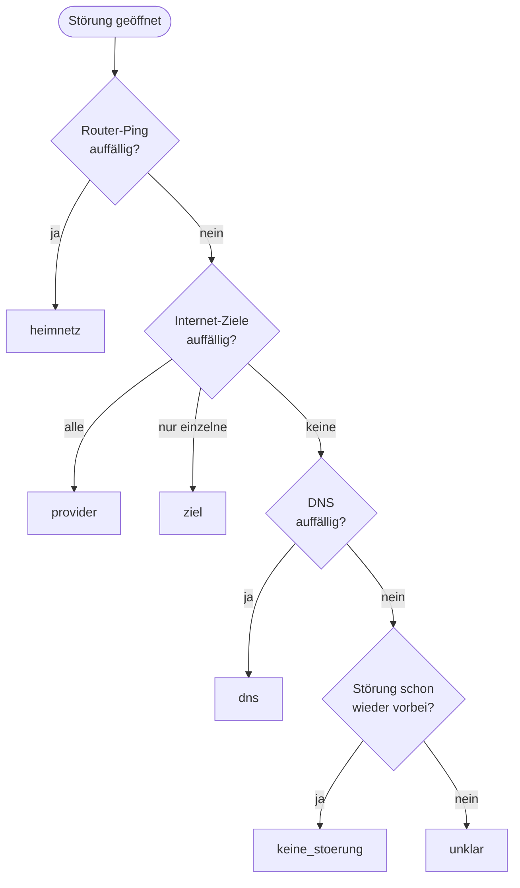

# Diagnose: Schwellwerte, Entscheidungsbaum und Testszenarien

> Sprint 0 · Stand 26.11.2026 · gehört zu [projektplan.md](projektplan.md), [datenmodell.md](datenmodell.md), [probes.md](probes.md)

Dieses Dokument legt fest, **wann** RootPing etwas als „nicht gut“ markiert, **wie** die Regel-Baseline die Ursache bestimmt und **mit welchen Szenarien** Regeln und KI im Labor verglichen werden.

## Getroffene Entscheidungen

| # | Frage | Entscheidung | Warum |
|---|---|---|---|
| 1 | Welche Ergebnisse gibt es? | `heimnetz`, `provider`, `ziel`, `dns`, `keine_stoerung`, `unklar` | Mit Router-Ping, mehreren Internet-Zielen und DNS lassen sich genau diese Fälle trennen. |
| 2 | Wann gilt etwas als „nicht gut“? | **Zwei Stufen:** Auffälligkeit (jede Abweichung) und Störung (anhaltend oder gehäuft) | Auch kleine Probleme sind sichtbar (Gaming), aber Diagnose und KI-Kosten entstehen nur bei echten Störungen. |
| 3 | Absolute oder relative Schwellen? | **Absolut und konfigurierbar** | 60 ms bleiben 60 ms, egal wie die Leitung sonst ist. Für Gaming richtig und leicht zu erklären. |
| 4 | Wie genau wird gemessen? | **1 Ping pro Sekunde**, zusammengefasst pro 10 s, **inklusive Maximalwert** | Ein Mittelwert von 25 ms kann einen 200-ms-Lag verstecken. |
| 5 | Traceroute? | **Ja, aber nur auf Anfrage:** per CLI, per MCP oder als Werkzeug des Agenten. Nie dauerhaft im Hintergrund. | Trennt „Provider“ von „weiter hinten im Internet“, ist aber langsam und leicht falsch zu deuten. |

> **Grenze, offen gesagt:** RootPing misst zum Router und zu öffentlichen Zielen (z. B. 1.1.1.1), nicht zum Spielserver selbst, weil viele Spielserver keine Pings beantworten. Ist die Leitung bis 1.1.1.1 sauber, liegt ein Lag im Spiel meist beim Spielserver. Das kann RootPing dann belegen.

## Stufe 1: Auffälligkeit

Jede gespeicherte Messrunde wird gegen diese Schwellen geprüft. Überschreitet ein Wert eine Schwelle, ist die Runde **auffällig**. Alle Werte stehen in `config.toml` unter `[thresholds]`.

| Wert | Schwelle (Standard) | Gilt für |
|---|---|---|
| Mittlere Latenz | > 60 ms (Internet), > 10 ms (Router) | Ping |
| Höchste Latenz in der Runde | > 100 ms | Ping |
| Paketverlust | > 0 % (jeder Verlust) | Ping |
| Jitter | > 10 ms | Ping |
| DNS-Antwortzeit | > 100 ms | DNS |
| DNS-Fehler | jeder Fehler (Timeout, SERVFAIL, …) | DNS |

**Gespeichert wird jede Messung**, auch unauffällige. Ob eine Runde auffällig ist, wird **beim Abfragen** aus den aktuellen Schwellen berechnet und nicht fest in die Datenbank geschrieben. So kann man die Schwellen ändern und sieht sofort auch alte Daten mit den neuen Werten.

## Stufe 2: Störung (Vorfall)

Eine Störung wird geöffnet, wenn für eine Probe **eine** dieser Bedingungen gilt:

- **Anhaltend:** 3 auffällige Runden hintereinander (≈ 30 s)
- **Gehäuft:** mindestens 4 auffällige Runden in den letzten 2 Minuten

Die zweite Regel ist wichtig für **kurze, wiederkehrende Aussetzer** (z. B. alle 30 s ein Lag), die für Gaming typisch sind und von „3 hintereinander“ nie erfasst würden.

Eine Störung wird **geschlossen**, wenn 6 Runden hintereinander (≈ 1 min) unauffällig sind. Dieser Unterschied zwischen Öffnen und Schließen heißt **Hysterese** und verhindert, dass eine Störung im Sekundentakt auf- und zugeht („Flattern“).

**Nicht als Störung zählen:** Messlücken (Ruhezustand) und die ersten Runden nach einem Netzwechsel. Dafür gibt es eigene Ereignisse (siehe Datenmodell).

Alle Zahlen (3, 4, 2 min, 6) sind konfigurierbar.

## Regel-Baseline: der Entscheidungsbaum

Wird eine Störung geöffnet, bestimmt die Regel-Baseline die Ursache aus den Messungen rund um den Beginn der Störung. Sie ist bewusst einfach und deterministisch: gleiche Daten, gleiches Ergebnis.



**Grundprinzip „die unterste Schicht gewinnt“:** Ein Problem im Heimnetz verursacht auch schlechte Internet- und DNS-Werte. Deshalb wird von unten nach oben geprüft, und die erste auffällige Schicht ist die Ursache.

**Unterscheidung innerhalb von `dns`** (nur für den Text, nicht für die Schicht):
- Nur der System-DNS (meist der Router) ist auffällig, der öffentliche DNS nicht → „DNS des Routers langsam oder gestört“
- Alle DNS-Server auffällig → „DNS allgemein gestört“

**Bekannte Schwäche (gewollt):** Bei **zwei gleichzeitigen** Ursachen (z. B. leichter Provider-Verlust und langsamer DNS) meldet der Baum nur die unterste. Genau hier soll die Auswertung zeigen, ob der Agent mehr findet.

**Fairness:** Die Regel-Baseline nutzt kein Traceroute, der Agent darf es nutzen. Das ist Absicht: Verglichen wird „feste Regeln“ gegen „KI mit Werkzeugen“. In der Auswertung wird zusätzlich festgehalten, wie oft der Agent Traceroute aufgerufen hat.

## Traceroute auf Anfrage

| Punkt | Festlegung |
|---|---|
| Auslöser | `rootping trace <ziel>` (CLI), MCP-Werkzeug `traceroute_now`, Agent-Werkzeug bei Störungen |
| Umsetzung | System-Befehl ohne Adminrechte: Windows `tracert -d -h 15 -w 1000`, Linux `traceroute -n -q 1 -w 1 -m 15`, sonst `tracepath -n` |
| Auswertung | Nur IP-Adressen, Zeiten und `*` werden gelesen, keine Texte. Mit `-d` / `-n` ist die Ausgabe weitgehend unabhängig von der Systemsprache. Getestet mit deutschen und englischen Beispielausgaben. |
| Grenzen | Höchstens 1 Traceroute pro Minute, nur einzelne Hosts, keine Adressbereiche |
| Speicherung | Tabelle `traceroutes` (siehe Datenmodell) |
| Deutung | Verlust oder hohe Zeit an einem **Zwischen-Hop** zählt nur, wenn er sich bis zum Ziel fortsetzt. Viele Router beantworten Traceroute absichtlich langsam; das ist kein Fehler. Diese Regel steht auch im Prompt des Agenten. |

## Testszenarien fürs Labor

**Aufbau:**

```
[ client ] ── lan ── [ router ] ── wan ── [ ziel-a ]   Ping-Ziel
 RootPing                                 [ ziel-b ]   Ping-Ziel
                                          [ dns ]      dnsmasq
```

netem wird auf dem jeweiligen Interface gesetzt: `lan` für Heimnetz-Fehler, `wan` für Provider-Fehler, direkt an `ziel-b` oder `dns` für Ziel- und DNS-Fehler.

| # | Szenario | netem / Aktion | Erwartete Schicht |
|---|---|---|---|
| 1 | `normal` | nichts | `keine_stoerung` (keine Störung darf entstehen) |
| 2 | `heimnetz_verlust` | `lan`: loss 10 % | `heimnetz` |
| 3 | `heimnetz_jitter` | `lan`: delay 20 ms 30 ms | `heimnetz` |
| 4 | `provider_verlust` | `wan`: loss 5 % | `provider` |
| 5 | `provider_latenz` | `wan`: delay 80 ms | `provider` |
| 6 | `ziel_verlust` | `ziel-b`: loss 30 % | `ziel` |
| 7 | `dns_aus` | `dns`: dnsmasq gestoppt | `dns` |
| 8 | `dns_langsam` | `dns`: delay 300 ms | `dns` |
| 9 | `kombiniert` | `wan`: loss 2 % **und** `dns`: delay 200 ms | `provider` + `dns` |
| 10 | `aussetzer` | `wan`: alle 30 s für 3 s loss 100 % | `provider` |

Jedes Szenario läuft **3-mal** (je ca. 3 Minuten), damit Zufall das Ergebnis nicht verzerrt. Szenario 1 läuft länger (ca. 15 Minuten), um Fehlalarme sichtbar zu machen.

## Kennzahlen der Auswertung

| Kennzahl | Bedeutung |
|---|---|
| **Trefferquote** | Anteil der Diagnosen mit richtiger (Haupt-)Schicht, getrennt für Regeln und Agent |
| **Konfusionsmatrix** | Welche Schicht wurde mit welcher verwechselt? |
| **Alle Ursachen gefunden** | Nur Szenario 9: Hat die Diagnose beide Ursachen genannt? |
| **Fehlalarme** | Störungen in Szenario 1 |
| **Zeit bis zur Erkennung** | Vom Start der Störung bis zum Öffnen des Vorfalls |
| **Kosten und Dauer** | Pro Agent-Diagnose (Tokens, US-Dollar, Sekunden) |
| **Traceroute-Aufrufe** | Wie oft der Agent tiefer gegraben hat, und ob es geholfen hat |

Das Ergebnis kommt als Tabelle und Konfusionsmatrix ins README.
