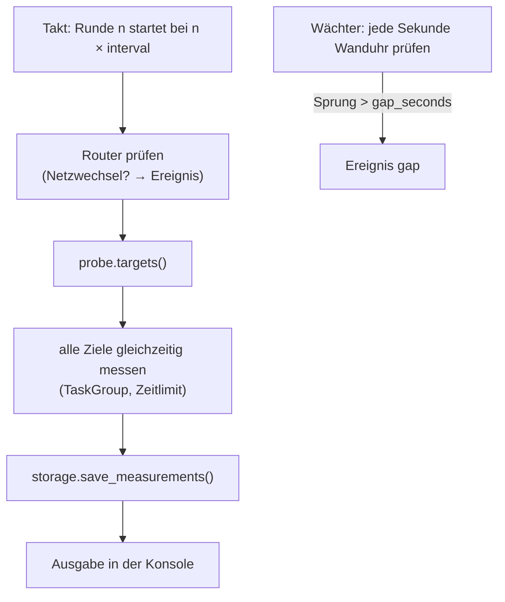

# Messdienst (Scheduler)

> Stand 27.11.2026 · Code: `src/rootping/scheduler.py`, `service.py` · gehört zu [probes.md](probes.md)

`rootping run` startet den Messdienst. Er läuft, bis man ihn mit Strg+C beendet, und zeigt jede gespeicherte Runde in der Konsole.

## Was beim Start passiert

1. Konfiguration lesen und prüfen (`config.py`). Fehler → Meldung mit Ort und Grund, Exit-Code 2.
2. Logging einrichten: Konsole (stderr) und Datei `run.log` im Log-Ordner des Systems.
3. Ping-Rechte prüfen. Fehlen sie → Erklärung mit Abhilfe, Exit-Code 3 ([ping.md](ping.md)).
4. Datenbank öffnen; fehlende Migrationen werden eingespielt ([datenmodell.md](datenmodell.md)).
5. Für jeden Eintrag in `PROBES`, der in der Konfiguration `enabled = true` hat, eine Probe erzeugen (`service.build_probes`).
6. Scheduler starten.

## Was der Scheduler tut



| Aufgabe | Wie | Warum so |
|---|---|---|
| **Takt** | Eine Schleife pro Probe. Runde *n* startet *n* × `interval` Sekunden nach dem Start (`loop.time()`). | Kein Auseinanderlaufen, auch wenn eine Runde länger dauert als das Intervall. Eine Ping-Runde dauert 10 s plus Timeout des letzten Echos, Runden überlappen sich also kurz. Das ist gewollt. |
| **Sicherheitsnetz** | Jede Messung hat ein Zeitlimit von `interval + timeout`. Ausnahme oder Zeitüberschreitung → Ergebnis mit `error = "probe_error"`, Details im Log. | Eine kaputte Probe darf die anderen nie anhalten. |
| **Messlücken** | Ein Wächter vergleicht jede Sekunde die Wanduhr (`time.time()`). Springt sie um mehr als `gap_seconds` (Standard 30), wird ein Ereignis `gap` gespeichert. Verpasste Runden werden übersprungen, nicht nachgeholt. | Nach dem Ruhezustand soll keine Störung gemeldet werden, sondern eine Lücke. Die Wanduhr läuft im Ruhezustand weiter, der asyncio-Takt unter Linux nicht ([tech-stack.md](tech-stack.md) 3.7). |
| **Netzwerk-Kontext** | Vor jeder Runde wird der Router erkannt. Ändert er sich (anderes WLAN, VPN, Kabel gezogen), wird ein Ereignis `network_change` mit altem und neuem Kontext gespeichert. | Die spätere Störungserkennung vergleicht nur Messungen aus demselben Netz. |
| **Speichern** | Nur der Scheduler ruft `storage` auf, eine Transaktion pro Runde. | Ein einziger Schreiber, keine Sperrkonflikte. |

## Ausgabe in der Konsole

```
ping_gateway   192.168.178.1   ø    2.3 ms  max    4.0 ms  Verlust   0.0 %  Jitter    0.8 ms
ping_internet  1.1.1.1         ø   14.1 ms  max   31.0 ms  Verlust  10.0 %  Jitter    3.2 ms
dns_lookup     192.168.178.1   ø   11.0 ms
dns_lookup     1.1.1.1         FEHLER: timeout
```

(Beispielwerte.) Die vollständigen Daten stehen in der Datenbank; abfragen lassen sie sich ab Sprint 2 mit `rootping status`, bis dahin mit jedem SQLite-Werkzeug.

## Ändern

- **Neue Probe:** siehe [probes.md](probes.md#eine-neue-probe-hinzufügen). Der Scheduler bleibt unverändert.
- **Anderes Verhalten bei Lücken oder Netzwechsel:** nur `scheduler.py`.
- **Schneller Probelauf:** `rootping run --rounds 1` misst eine Runde pro Probe und beendet sich.
