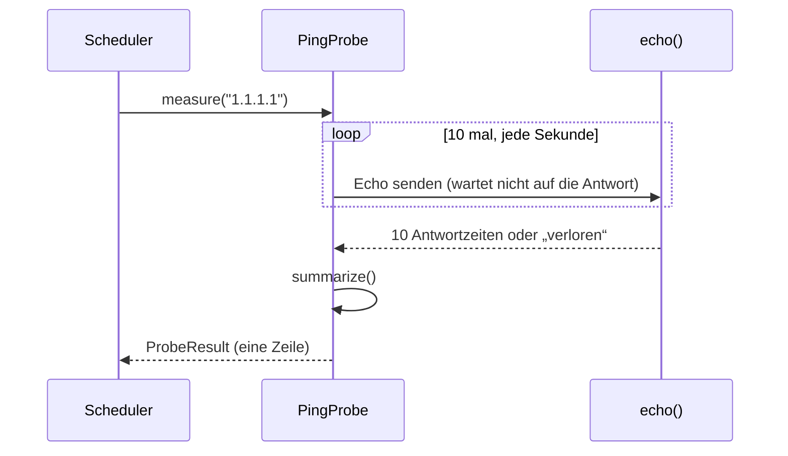

# Ping: wie RootPing misst

> Stand 27.11.2026 · Code: `src/rootping/probes/ping.py`, `net/icmp.py`, `platform/` · Entscheidung: [ADR-006](adr/006-ping-ueber-betriebssystem-schnittstellen.md), [ADR-011](adr/011-ping-ziele-adressen-namen-nur-auf-wunsch.md)

## Kurz gesagt

- Zwei Messungen: `ping_gateway` (zum eigenen Router) und `ping_internet` (Standard: 1.1.1.1 und 9.9.9.9).
- **Jede Sekunde ein Echo**, fest getaktet. Nach 10 Sekunden werden die 10 Antworten zu einer Zeile zusammengefasst: Mittelwert, Höchstwert, Verlust und Jitter.
- **Ohne Adminrechte** auf Windows und **ohne root** auf Linux.
- Ziele sind IPv4-Adressen. Websites oder Spieldienste per Name nur mit `allow_hostnames = true` ([unten](#websites-gezielt-testen)).

## Eine Runde im Ablauf



**Warum fester Takt?** Würde man nach jedem Echo auf Antwort oder Timeout warten, dauerte eine Runde bei Paketverlust bis zu 29 statt 11 Sekunden (Befund B2, Test T3). Gerade bei Störungen wären die Zeitfenster dann falsch. Deshalb startet Echo Nummer *i* genau *i* Sekunden nach Rundenbeginn, egal was mit den anderen ist (`fixed_rate_echoes()`).

**Warum der Höchstwert?** Ein Mittelwert von 25 ms kann einen einzelnen 200-ms-Ausreißer verstecken, der im Online-Spiel als Lag spürbar ist ([diagnose.md](diagnose.md)).

## Die Kennzahlen

| Spalte | Berechnung |
|---|---|
| `latency_ms` | Mittelwert der erhaltenen Antwortzeiten |
| `max_ms` | höchste erhaltene Antwortzeit |
| `loss_pct` | Anteil verlorener Echos in Prozent |
| `jitter_ms` | Mittel der Abstände aufeinanderfolgender Antwortzeiten, verlorene übersprungen ([Definition](diagnose.md#jitter-definition)) |
| `ok` | 1, wenn mindestens eine Antwort kam |
| `error` | `no_reply` (keine einzige Antwort), `no_gateway` (kein Router erkannt), `resolve_failed` (Name ließ sich nicht auflösen, nur mit `allow_hostnames`), `probe_error` (Fehler im Programm) |

## Websites gezielt testen

Standardmäßig sind nur IPv4-Adressen erlaubt, damit Ping nie vom DNS abhängt ([ADR-011](adr/011-ping-ziele-adressen-namen-nur-auf-wunsch.md)). Wer eine bestimmte Website oder einen Spieldienst testen will, schaltet Namen für `ping_internet` ein:

```toml
[probes.ping_internet]
targets = ["1.1.1.1", "www.ea.com"]
allow_hostnames = true
```

- Nur den Namen eintragen, ohne `https://` und ohne Pfad.
- Der Name wird vor jeder Runde über das Betriebssystem aufgelöst (wie im Browser). Gemessen wird die Adresse, die dabei herauskommt; gespeichert wird der Name.
- Klappt die Auflösung nicht, steht in der Runde `error = resolve_failed` und **kein** Verlust. So sieht man: Das Problem ist DNS, nicht die Leitung.
- `rootping check` zeigt, in welche Adresse ein Name gerade aufgelöst wird.
- Hinweis: Manche Server beantworten keine Pings (Firewall). Dann zeigt RootPing dauerhaft `no_reply`, obwohl die Website funktioniert. `rootping check` macht das vorab sichtbar.

## Windows: ICMP-API wie `ping.exe`

`platform/windows.py` ruft `IcmpSendEcho2` aus der System-Bibliothek `Iphlpapi.dll` über `ctypes` auf. Das ist derselbe Weg, den `ping.exe` nutzt, und er braucht keine Adminrechte. Der Aufruf blockiert, deshalb läuft er mit `asyncio.to_thread` in einem Hilfs-Thread.

- Windows liefert **ganze Millisekunden**; unter 1 ms erscheint 0 (wie „<1ms“ bei `ping.exe`). Im Heimnetz antwortet der Router meist in unter 1 ms. Unter Windows stehen bei `ping_gateway` deshalb oft `0.0 ms` und Jitter `0.0`. Das ist kein Fehler, sondern die Auflösung der Windows-Schnittstelle (im Windows-Test bestätigt). Für Spiele relevante Werte (ab einigen ms) sind davon nicht betroffen. Unter Linux misst RootPing auf Mikrosekunden genau.
- Der Router wird mit `GetAdaptersAddresses` und `GetBestRoute` ermittelt, auch bei aktivem VPN der Heimrouter ([netzwerk.md](netzwerk.md)).

### Test ohne Adminrechte (offener Punkt aus Sprint 0)

Die GitHub-Windows-Runner laufen als Administrator. Die CI beweist also, dass der Code funktioniert, aber nicht, dass er **ohne** Admin funktioniert. Das prüft dieser Test auf einem normalen Windows-Konto:

```powershell
# In einem normalen PowerShell-Fenster (NICHT „Als Administrator ausführen“)
git clone https://github.com/trais92/rootping
cd rootping
uv sync
uv run rootping check
```

Erwartet: `Ping-Rechte: OK`, der Router mit Adresse und Netzwerkkarte, VPN und DNS-Server, je drei Antwortzeiten für Router und 1.1.1.1 sowie DNS-Antwortzeiten. Kommen dort Zahlen, ist ADR-006 bestätigt und das Risiko im Projektplan erledigt.

## Linux: Ping-Socket des Kernels

`platform/linux.py` nutzt `icmplib` mit `privileged=False`. Dann baut der Kernel die ICMP-Pakete (Datagram-Socket), und es braucht kein root. Der Router kommt aus `/proc/net/route`, bei VPN mit Erkennung des Tunnels ([netzwerk.md](netzwerk.md)).

### Wenn Ping nicht erlaubt ist

Der Kernel erlaubt solche Sockets nur den Gruppen im Bereich `net.ipv4.ping_group_range`. Der Kernel-Standard ist `1 0` (niemand). systemd setzt auf den meisten Distributionen `0 2147483647` (alle). Ausnahmen gibt es, zum Beispiel die Ubuntu-Runner von GitHub (Befund B3, live bestätigt im ersten CI-Lauf).

`rootping run` und `rootping check` prüfen das beim Start und brechen mit einer Erklärung ab:

```
Ping ohne root-Rechte ist auf diesem System nicht freigegeben.
Der Linux-Kernel erlaubt Ping-Sockets nur den Gruppen im Bereich net.ipv4.ping_group_range (aktuell: 1 0; deine Gruppen: 1000, 27).

Abhilfe (einmalig, mit Admin-Rechten):
  sudo sysctl -w net.ipv4.ping_group_range="0 2147483647"
Dauerhaft (übersteht einen Neustart):
  echo 'net.ipv4.ping_group_range = 0 2147483647' | sudo tee /etc/sysctl.d/99-rootping.conf
```

Wer es enger fassen will, trägt statt `0 2147483647` nur die eigene Gruppennummer ein (`id -g`), z. B. `1000 1000`.

## Was bewusst nicht geht

- **Namen als Ziel** (`dns.google`): nein, nur IPv4-Adressen. Sonst sähe eine DNS-Störung aus wie Paketverlust ([ADR-011](adr/011-ping-ziele-adressen-namen-nur-auf-wunsch.md)).
- **IPv6:** nicht in v1. Beide Systeme hätten dafür eigene Funktionen (`Icmp6SendEcho2`, ICMPv6-Socket); eine Erweiterung beträfe nur `platform/` und die Prüfung der Ziele.
- **Notlösung System-`ping`:** dokumentiert in ADR-006, aber nicht gebaut, solange die ICMP-API funktioniert.

## Ändern

| Ich will … | Datei |
|---|---|
| andere Ziele oder Intervalle | `config.toml` ([konfiguration.md](konfiguration.md)) |
| eine andere Kennzahl | `probes/summary.py` + Test in `tests/test_summary.py` |
| den Ping-Weg eines Systems tauschen | nur `platform/windows.py` oder `platform/linux.py` |
