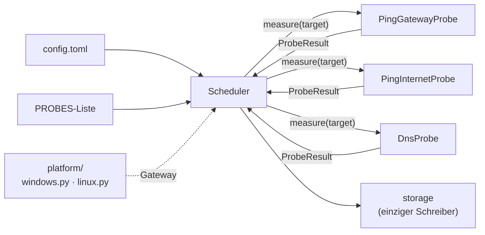

# Probe-Schnittstelle

> Sprint 0 · Stand 27.11.2026 (an [tech-stack.md](tech-stack.md) und ADR-006/010 angepasst; in Sprint 1 umgesetzt, Abweichungen vom Entwurf unten markiert) · gehört zu [projektplan.md](projektplan.md) und [datenmodell.md](datenmodell.md)

Eine **Probe** ist eine Messung, z. B. „Ping zum Router“. Dieses Dokument legt fest, wie eine Probe aussieht, wie sie gestartet wird und wie man eine neue hinzufügt.

## Getroffene Entscheidungen

| # | Frage | Entscheidung | Warum |
|---|---|---|---|
| 1 | Speichert eine Probe selbst? | **Nein.** Sie misst und gibt ein `ProbeResult` zurück. Gespeichert wird zentral. | Probes sind ohne Datenbank testbar und laufen unverändert im Labor. |
| 2 | Wie laufen mehrere Messungen gleichzeitig? | **`asyncio`** (`TaskGroup`, `asyncio.timeout`) | `dnspython` und der Linux-Ping (`icmplib`) unterstützen es direkt; der blockierende Windows-Ping läuft über `asyncio.to_thread`. Sonst keine Threads, also keine gleichzeitigen Schreibzugriffe. Siehe [tech-stack.md](tech-stack.md#37-nebenläufigkeit-und-scheduler-). |
| 3 | Wie wird eine Probe bekannt gemacht? | **Einfache Liste im Code** (`PROBES`) plus Konfiguration | Auf einen Blick sichtbar, was es gibt. Ein späterer Wechsel auf automatische Plugin-Suche (Entry Points) ändert die Probes selbst nicht. |

## `asyncio` in drei Sätzen

Eine Messung wartet fast die ganze Zeit auf eine Antwort. `async def` macht eine Funktion „wartefähig“, `await` markiert die Stelle, an der gewartet wird. Während eine Probe wartet, laufen die anderen weiter, alles in einem einzigen Programmteil.

## Bausteine



| Baustein | Aufgabe |
|---|---|
| `ProbeResult` | Ergebnis einer Messrunde, entspricht einer Zeile in `measurements` |
| `Probe` | Basisklasse, die jede Messung erfüllen muss |
| `PROBES` | Liste aller verfügbaren Probes |
| Scheduler | Startet Probes im eingestellten Intervall, fängt Fehler ab, gibt Ergebnisse an `storage` |
| `platform` | Betriebssystem-spezifisches, z. B. Gateway erkennen |

## Die Schnittstelle (Entwurf)

> **Umgesetzt in Sprint 1** in `src/rootping/probes/base.py`, mit zwei kleinen Abweichungen vom Entwurf unten:
> 1. `Probe` ist generisch (`Probe[PingSettings]`), damit Pyright weiß, welche Felder `self.settings` hat.
> 2. `targets()` ist abstrakt, weil jede Probe ihre Ziele anders bestimmt (Ping: Liste oder `auto`, DNS: Platzhalter `gateway`/`system`).

```python
"""Gemeinsame Schnittstelle für alle Messungen (Probes)."""

from abc import ABC, abstractmethod
from dataclasses import dataclass
from datetime import datetime


@dataclass(frozen=True)
class ProbeResult:
    """Ergebnis einer Messrunde gegen ein Ziel.

    Entspricht einer Zeile der Tabelle ``measurements`` (siehe docs/datenmodell.md).
    Felder, die für eine Messart keinen Sinn ergeben (z. B. Jitter bei DNS), bleiben None.
    """

    probe: str               # z. B. "ping_internet"
    target: str              # z. B. "1.1.1.1"
    ts: datetime             # Zeitpunkt in UTC
    ok: bool                 # Hat die Messung grundsätzlich funktioniert?
    latency_ms: float | None = None
    loss_pct: float | None = None
    jitter_ms: float | None = None
    max_ms: float | None = None   # höchste Antwortzeit der Runde
    error: str | None = None  # z. B. "timeout", "servfail"


class Probe(ABC):
    """Basisklasse für eine Messung.

    Eine Probe misst nur. Sie speichert nichts, kennt keine Datenbank und
    keine anderen Probes. Ziele, Intervall und Timeout kommen aus der Konfiguration.
    """

    name: str  # eindeutiger Name, gleich dem Schlüssel in PROBES und in der Konfiguration

    def __init__(self, settings: ProbeSettings) -> None:
        """Übernimmt den geprüften Abschnitt [probes.<name>] aus der Konfiguration.

        ``ProbeSettings`` ist ein Pydantic-Modell (ADR-010). Jede Probe hat eine
        eigene Unterklasse mit ihren Feldern; Tippfehler fallen beim Start auf.
        """
        self.settings = settings

    def targets(self) -> list[str]:
        """Liefert die Ziele dieser Probe. Standard: Liste aus der Konfiguration."""
        return self.settings.targets

    @abstractmethod
    async def measure(self, target: str) -> ProbeResult:
        """Führt eine Messrunde gegen ``target`` aus und gibt das Ergebnis zurück.

        Darf keine Ausnahme für „Ziel nicht erreichbar“ werfen, sondern gibt
        ``ok=False`` mit passender ``error``-Angabe zurück.
        """
```

**Sonderfall Gateway:** `PingGatewayProbe` überschreibt `targets()`. Steht in der Konfiguration `targets = ["auto"]`, fragt sie das `platform`-Modul nach der Router-Adresse. Im Labor steht dort stattdessen die feste Adresse des Router-Containers.

## Registrierung und Konfiguration

```python
# rootping/probes/__init__.py
"""Liste aller verfügbaren Probes. Neue Probe = eine neue Zeile."""

PROBES: dict[str, type[Probe]] = {
    "ping_gateway":  PingGatewayProbe,
    "ping_internet": PingInternetProbe,
    "dns_lookup":    DnsProbe,
}
```

```toml
# config.toml (Standardwerte)
[probes.ping_gateway]
enabled  = true
targets  = ["auto"]
interval = 10      # Sekunden pro Runde (eine Zeile in der Datenbank)
                   # Gesendet wird fest 1 Echo pro Sekunde, also 10 pro Runde (ADR-006)
timeout  = 2       # Sekunden pro Echo; Echos dürfen sich überlappen

[probes.ping_internet]
enabled  = true
targets  = ["1.1.1.1", "9.9.9.9"]
interval = 10
timeout  = 2

[probes.dns_lookup]
enabled  = true
targets  = ["gateway", "system", "1.1.1.1"]
# "gateway" = DNS-Anfrage direkt an die Router-IP (E7, tech-stack.md 3.10)
# "system"  = DNS-Server des Betriebssystems; unter Linux mit systemd-resolved
#             ist das oft der lokale Cache 127.0.0.53, nicht der Router
query    = "example.com"
interval = 30
timeout  = 3
```

Für das Labor gibt es eine zweite Datei `config.lab.toml` mit den Container-Adressen. **Der Code ist derselbe, nur die Konfiguration ist anders.**

## Was der Scheduler übernimmt

Damit Probes klein bleiben, erledigt der Scheduler alles Gemeinsame an einer Stelle:

1. **Takt:** Jede aktivierte Probe läuft in ihrem eigenen Intervall, driftfrei über `loop.time()`; alle Ziele einer Runde werden in einer `asyncio.TaskGroup` gleichzeitig gemessen. Der Ping sendet innerhalb der Runde fest jede Sekunde ein Echo, ohne auf die Antwort zu warten, und berechnet Mittelwert, Maximum, Verlust und Jitter selbst (`summarize()`, siehe [diagnose.md](diagnose.md#jitter-definition)).
2. **Sicherheitsnetz:** Hängt eine Probe länger als ihr Timeout oder wirft sie unerwartet eine Ausnahme, wird daraus ein `ProbeResult` mit `ok=False, error="probe_error"`. Ein Fehler in einer Probe stoppt nie die anderen.
3. **Messlücken:** Springt die Wanduhr deutlich weiter als erwartet (z. B. nach dem Ruhezustand), schreibt der Scheduler ein Ereignis `gap` statt einer Störung. *Umgesetzt* als Wächter, der jede Sekunde prüft, Schwelle `service.gap_seconds` ([messdienst.md](messdienst.md)).
4. **Netzwerk-Kontext:** Vor jeder Runde prüft er Gateway und Interface. Hat sich etwas geändert, legt er einen neuen Kontext an und schreibt ein Ereignis `network_change`.
5. **Speichern:** Ergebnisse gehen an `storage`, das als einziges in die Datenbank schreibt.

## Eine neue Probe hinzufügen

1. Klasse in `src/rootping/probes/<name>.py` anlegen, dazu ein Einstellungsmodell, das von `ProbeSettings` erbt. Die Probe erbt von `Probe[<Einstellungen>]`, setzt `name` und schreibt `targets()` und `measure()` (mit Docstrings).
2. Eine Zeile in `PROBES` (`src/rootping/probes/__init__.py`) ergänzen.
3. Ein gleichnamiges Feld in `ProbesSettings` (`src/rootping/config.py`) ergänzen. Ein Test prüft, dass `PROBES` und `ProbesSettings` dieselben Namen haben.
4. Abschnitt `[probes.<name>]` mit Standardwerten in `config.example.toml` ergänzen (ein Test vergleicht ihn mit dem Code).
5. Test mit einem gefälschten Netzwerkaufruf schreiben (siehe unten).
6. Diese Seite und [architektur.md](architektur.md) um die neue Probe ergänzen.

Nicht nötig: Datenbank, Scheduler oder andere Probes anfassen.

## Testen

- **Unit-Tests:** Der eigentliche Netzwerkaufruf (`echo()` aus `rootping/net/icmp.py`, `query()` aus `rootping/net/dns_query.py`) wird durch eine Fälschung ersetzt. Die Probes nehmen ihn dafür als optionalen Parameter entgegen (`PingInternetProbe(settings, echo=fake)`). So prüft man z. B., dass bei 2 von 10 verlorenen Paketen `loss_pct == 20.0` herauskommt, ohne Netzwerk.
- **`FakeProbe`:** Eine Probe für Tests, die vorgegebene Ergebnisse liefert. Damit lassen sich Scheduler, Störungserkennung und Regeln testen.
- **Labor:** Die echten Probes laufen gegen die Container (ab Sprint 2).

## Und Traceroute?

Traceroute ist **keine Probe**, weil es nicht regelmäßig läuft. Es ist ein Werkzeug, das nur auf Anfrage startet (CLI, MCP, Agent). Details in [diagnose.md](diagnose.md#traceroute-auf-anfrage).

## Windows-Hinweis

Ping läuft auf beiden Systemen **ohne Adminrechte**, aber über verschiedene Wege ([ADR-006](adr/006-ping-ueber-betriebssystem-schnittstellen.md)):

- **Windows:** Windows-ICMP-API `IcmpSendEcho2` aus `Iphlpapi.dll` über `ctypes`, derselbe Weg wie `ping.exe`. `icmplib` scheidet hier aus, weil es unter Windows immer einen Raw Socket öffnet und damit Admin braucht (Befund B1). Laufzeiten kommen in ganzen Millisekunden.
- **Linux:** ICMP-Datagram-Socket über `icmplib` (`async_ping(count=1, privileged=False)`). Voraussetzung: `net.ipv4.ping_group_range` erlaubt die Gruppe des Nutzers (Befund B3). Ist das nicht so, meldet RootPing das beim Start mit einer verständlichen Anleitung.

Beides steckt hinter einer Funktion `echo(target, timeout) -> float | None` in `rootping/net/icmp.py`. Die Windows-Umsetzung prüft ein Spike am Anfang von Sprint 1 auf Kais PC **ohne erhöhte Rechte** (GitHub-Windows-Runner laufen als Admin). Notlösung, falls die API wider Erwarten scheitert: System-`ping` aufrufen. Ein Wechsel betrifft nur `icmp.py`.
