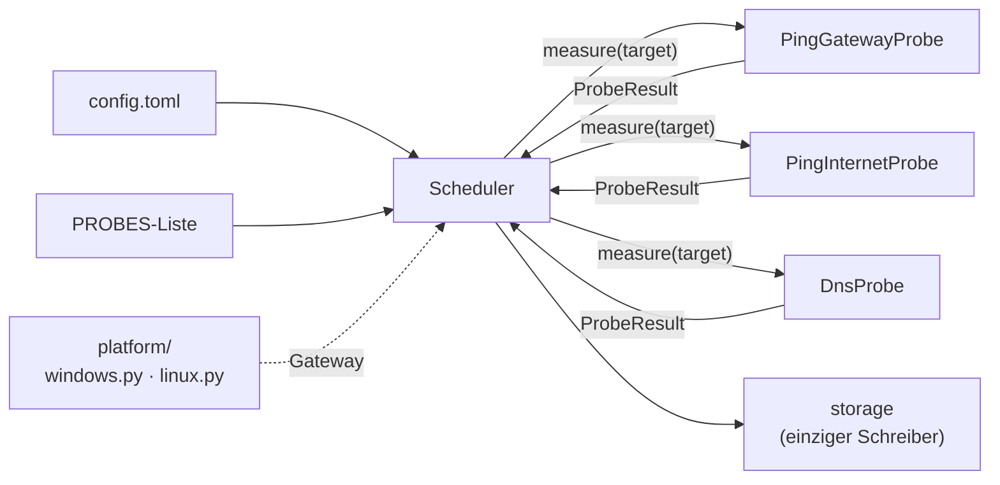

# Probe-Schnittstelle

> Sprint 0 · Stand 26.11.2026 · gehört zu [projektplan.md](projektplan.md) und [datenmodell.md](datenmodell.md)

Eine **Probe** ist eine Messung, z. B. „Ping zum Router“. Dieses Dokument legt fest, wie eine Probe aussieht, wie sie gestartet wird und wie man eine neue hinzufügt.

## Getroffene Entscheidungen

| # | Frage | Entscheidung | Warum |
|---|---|---|---|
| 1 | Speichert eine Probe selbst? | **Nein.** Sie misst und gibt ein `ProbeResult` zurück. Gespeichert wird zentral. | Probes sind ohne Datenbank testbar und laufen unverändert im Labor. |
| 2 | Wie laufen mehrere Messungen gleichzeitig? | **`asyncio`** | `icmplib` und `dnspython` unterstützen es direkt. Keine Threads, also keine gleichzeitigen Schreibzugriffe. |
| 3 | Wie wird eine Probe bekannt gemacht? | **Einfache Liste im Code** (`PROBES`) plus Konfiguration | Auf einen Blick sichtbar, was es gibt. Ein späterer Wechsel auf automatische Plugin-Suche (Entry Points) ändert die Probes selbst nicht. |

## `asyncio` in drei Sätzen

Eine Messung wartet fast die ganze Zeit auf eine Antwort. `async def` macht eine Funktion „wartefähig“, `await` markiert die Stelle, an der gewartet wird. Während eine Probe wartet, laufen die anderen weiter, alles in einem einzigen Programmteil.

## Bausteine



| Baustein | Aufgabe |
|---|---|
| `ProbeResult` | Ergebnis einer Messrunde, entspricht einer Zeile in `measurements` |
| `Probe` | Basisklasse, die jede Messung erfüllen muss |
| `PROBES` | Liste aller verfügbaren Probes |
| Scheduler | Startet Probes im eingestellten Intervall, fängt Fehler ab, gibt Ergebnisse an `storage` |
| `platform` | Betriebssystem-spezifisches, z. B. Gateway erkennen |

## Die Schnittstelle (Entwurf)

```python
"""Gemeinsame Schnittstelle für alle Messungen (Probes)."""

from abc import ABC, abstractmethod
from dataclasses import dataclass
from datetime import datetime


@dataclass(frozen=True)
class ProbeResult:
    """Ergebnis einer Messrunde gegen ein Ziel.

    Entspricht einer Zeile der Tabelle ``measurements`` (siehe docs/datenmodell.md).
    Felder, die für eine Messart keinen Sinn ergeben (z. B. Jitter bei DNS), bleiben None.
    """

    probe: str               # z. B. "ping_internet"
    target: str              # z. B. "1.1.1.1"
    ts: datetime             # Zeitpunkt in UTC
    ok: bool                 # Hat die Messung grundsätzlich funktioniert?
    latency_ms: float | None = None
    loss_pct: float | None = None
    jitter_ms: float | None = None
    error: str | None = None  # z. B. "timeout", "servfail"


class Probe(ABC):
    """Basisklasse für eine Messung.

    Eine Probe misst nur. Sie speichert nichts, kennt keine Datenbank und
    keine anderen Probes. Ziele, Intervall und Timeout kommen aus der Konfiguration.
    """

    name: str  # eindeutiger Name, gleich dem Schlüssel in PROBES und in der Konfiguration

    def __init__(self, settings: dict) -> None:
        """Übernimmt den Abschnitt [probes.<name>] aus der Konfiguration."""
        self.settings = settings

    def targets(self) -> list[str]:
        """Liefert die Ziele dieser Probe. Standard: Liste aus der Konfiguration."""
        return self.settings["targets"]

    @abstractmethod
    async def measure(self, target: str) -> ProbeResult:
        """Führt eine Messrunde gegen ``target`` aus und gibt das Ergebnis zurück.

        Darf keine Ausnahme für „Ziel nicht erreichbar“ werfen, sondern gibt
        ``ok=False`` mit passender ``error``-Angabe zurück.
        """
```

**Sonderfall Gateway:** `PingGatewayProbe` überschreibt `targets()`. Steht in der Konfiguration `targets = ["auto"]`, fragt sie das `platform`-Modul nach der Router-Adresse. Im Labor steht dort stattdessen die feste Adresse des Router-Containers.

## Registrierung und Konfiguration

```python
# rootping/probes/__init__.py
"""Liste aller verfügbaren Probes. Neue Probe = eine neue Zeile."""

PROBES: dict[str, type[Probe]] = {
    "ping_gateway":  PingGatewayProbe,
    "ping_internet": PingInternetProbe,
    "dns_lookup":    DnsProbe,
}
```

```toml
# config.toml (Standardwerte)
[probes.ping_gateway]
enabled  = true
targets  = ["auto"]
interval = 10      # Sekunden zwischen zwei Runden
count    = 5       # Pakete pro Runde
timeout  = 2       # Sekunden

[probes.ping_internet]
enabled  = true
targets  = ["1.1.1.1", "9.9.9.9"]
interval = 10
count    = 5
timeout  = 2

[probes.dns_lookup]
enabled  = true
targets  = ["system", "1.1.1.1"]   # "system" = DNS-Server des Betriebssystems
query    = "example.com"
interval = 30
timeout  = 3
```

Für das Labor gibt es eine zweite Datei `config.lab.toml` mit den Container-Adressen. **Der Code ist derselbe, nur die Konfiguration ist anders.**

## Was der Scheduler übernimmt

Damit Probes klein bleiben, erledigt der Scheduler alles Gemeinsame an einer Stelle:

1. **Takt:** Jede aktivierte Probe läuft in ihrem eigenen Intervall; alle Ziele einer Runde werden mit `asyncio.gather` gleichzeitig gemessen.
2. **Sicherheitsnetz:** Hängt eine Probe länger als ihr Timeout oder wirft sie unerwartet eine Ausnahme, wird daraus ein `ProbeResult` mit `ok=False, error="probe_error"`. Ein Fehler in einer Probe stoppt nie die anderen.
3. **Messlücken:** Liegt zwischen zwei Runden deutlich mehr Zeit als das Intervall (z. B. nach dem Ruhezustand), schreibt der Scheduler ein Ereignis `gap` statt einer Störung.
4. **Netzwerk-Kontext:** Vor jeder Runde prüft er Gateway und Interface. Hat sich etwas geändert, legt er einen neuen Kontext an und schreibt ein Ereignis `network_change`.
5. **Speichern:** Ergebnisse gehen an `storage`, das als einziges in die Datenbank schreibt.

## Eine neue Probe hinzufügen

1. Klasse in `rootping/probes/<name>.py` anlegen, von `Probe` erben, `name` setzen, `measure()` schreiben (mit Docstring).
2. Eine Zeile in `PROBES` ergänzen.
3. Abschnitt `[probes.<name>]` in `config.toml` mit Standardwerten ergänzen.
4. Test mit einem gefälschten Netzwerkaufruf schreiben (siehe unten).
5. Diese Seite um die neue Probe ergänzen.

Nicht nötig: Datenbank, Scheduler oder andere Probes anfassen.

## Testen

- **Unit-Tests:** Der eigentliche Netzwerkaufruf (`icmplib.async_ping`, `dns.asyncresolver`) wird durch eine Fälschung ersetzt (Mock). So prüft man z. B., dass bei 2 von 5 verlorenen Paketen `loss_pct == 40.0` herauskommt, ohne Netzwerk.
- **`FakeProbe`:** Eine Probe für Tests, die vorgegebene Ergebnisse liefert. Damit lassen sich Scheduler, Störungserkennung und Regeln testen.
- **Labor:** Die echten Probes laufen gegen die Container (ab Sprint 2).

## Windows-Hinweis

`icmplib` wird mit `privileged=False` aufgerufen, damit kein Admin nötig ist. Ob das unter Windows zuverlässig klappt, prüft ein kurzer Spike am Anfang von Sprint 1. Plan B: `PingProbe` ruft den System-`ping` auf. Weil der Rest nur `measure()` kennt, betrifft ein Wechsel nur diese eine Klasse.
