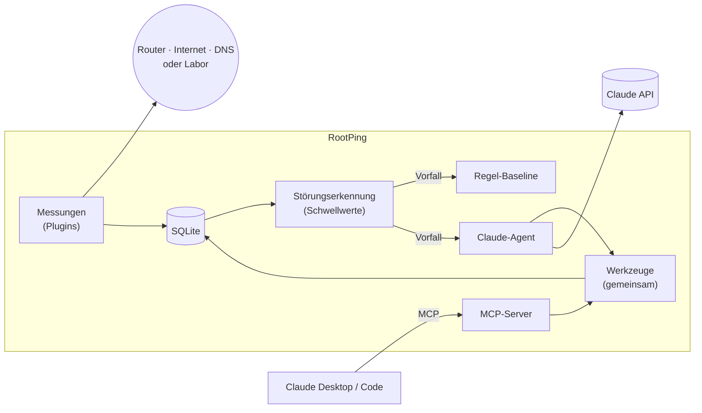

# RootPing – Projektplan (Lite-Version)

> Stand: 26.11.2026 · Entwurf für Sprint 0 · ersetzt den ursprünglichen „layerwatch“-Plan
> Umfang: 5 Sprints à 1 Woche, ca. 10 Stunden pro Sprint, plus Sprint 0 (Theorie)

**Pitch:** *„Mein Agent findet heraus, warum dein Internet hakt, und ich habe gemessen, wie oft er recht hat.“*

---

## 1. Ziel

**Problem:** „Das Internet hakt“, aber woran liegt es? Am Router, am Provider oder am DNS? Ohne Messdaten bleibt nur Raten.

**Lösung:** RootPing misst im Hintergrund wenige, aussagekräftige Werte, speichert sie in SQLite und erkennt Störungen. Bei einer Störung grenzt ein Claude-Agent die Ursache Schicht für Schicht ein und belegt jede Aussage mit Messwerten. Über einen MCP-Server kann man dieselben Daten aus Claude Desktop oder Claude Code heraus befragen.

**Das Herzstück:** Eine Störungssimulation (Docker + `tc netem`) erzeugt Fehler mit bekannter Ursache. Damit wird gemessen, wie oft der KI-Agent die richtige Ursache findet, im Vergleich zu einem einfachen regelbasierten Entscheidungsbaum.

**Was das Projekt in Bewerbungen zeigt:**
- Agent mit Werkzeugen (Tool Use) und MCP-Server praktisch umgesetzt
- KI wird **nicht blind vertraut**, sondern mit einer Auswertung gegen eine Baseline geprüft
- Strukturierte Fehlereingrenzung wie im IT-Betrieb
- Saubere Projektarbeit: Plan, Entscheidungen (ADRs), Tests, CI

> **Warum so schlank?** Der Originalplan hatte 8 Sprints, 5 Schichten, 3 Betriebssysteme und ein Dashboard. Für eine Bewerbung zählt, dass das Projekt *fertig* ist und in 2 Minuten verstanden wird. Die Auswertung „KI vs. Regeln“ ist das, was es von hundert anderen Ping-Tools unterscheidet. Alles andere ist Beiwerk.

---

## 2. Umfang

| In v1 | Nicht in v1 (bewusst gestrichen) |
|---|---|
| Ping zum Router (Gateway automatisch erkannt) | WLAN-Werte (stark plattformabhängig) |
| Ping zu 2–3 Internet-Zielen | macOS, Windows-Dienst/Autostart |
| DNS-Abfragen gegen System-DNS und einen öffentlichen DNS | Traceroute, HTTPS-Prüfungen, ARP-Geräteliste |
| SQLite-Speicherung | Dashboard (stattdessen CLI) |
| Störungserkennung mit festen Schwellwerten | Normalwerte nach Tageszeit (braucht Wochen an Daten) |
| Regel-Baseline (Entscheidungsbaum) | Wochenbericht, Desktop-Benachrichtigungen |
| Claude-Agent mit Werkzeugen | Releases für alle Systeme |
| MCP-Server (gleiche Werkzeuge) | |
| Störungslabor (Docker + netem) und Auswertung | |

Zielplattform: **Linux** (das Labor läuft ohnehin in Linux-Containern). Windows ist „schön, wenn es geht“, aber kein Ziel.

---

## 3. Messungen

| Messung | Was | Intervall (Vorschlag) | Bibliothek |
|---|---|---|---|
| `ping_gateway` | Latenz, Paketverlust, Jitter zum Router | 10 s, je 5 Pakete | `icmplib` (ohne Root möglich) |
| `ping_internet` | dasselbe zu 2–3 Zielen (z. B. 1.1.1.1, 9.9.9.9) | 10 s | `icmplib` |
| `dns_lookup` | Antwortzeit, Erfolg, Fehlerart (Timeout, SERVFAIL, NXDOMAIN) pro DNS-Server | 30 s | `dnspython` |

**Warum genau diese drei?** Sie reichen für die wichtigste Unterscheidung: *Heimnetz kaputt* (Router-Ping schlecht) vs. *Provider/Internet kaputt* (Router gut, Internet schlecht) vs. *DNS kaputt* (Pings gut, DNS schlecht). Mehr Messungen machen den Agenten nicht klüger, nur das Projekt größer.

Jede Messung speichert zusätzlich den **Netzwerk-Kontext** (Gateway-IP, Interface). So lässt sich ein Netzwechsel (anderes WLAN, VPN an) von einer echten Störung unterscheiden.

---

## 4. Architektur



**Kernideen**
1. **Messungen sind austauschbare Plugins** mit gemeinsamer Schnittstelle. Wichtig für das Labor: Dieselben Messungen laufen gegen das echte Netz oder gegen die Container, nur die Ziele kommen aus der Konfiguration.
2. **Erst Regeln, dann KI.** Die Erkennung „da stimmt was nicht“ ist simple Statistik ohne KI. Claude wird nur gefragt, *warum*. Das ist günstig, testbar und nachvollziehbar.
3. **Ein Werkzeugsatz, zwei Nutzer.** Agent und MCP-Server rufen dieselben Python-Funktionen auf (z. B. `get_recent_measurements`, `get_incident`, `ping_now`, `dns_lookup_now`).
4. **Diagnose als strukturierte Antwort:** betroffene Schicht, Ursache, Belege (Messwerte), Sicherheit, Empfehlung. Nur so kann man KI und Regeln automatisch vergleichen.

---

## 5. Auswertung (Herzstück)

**Aufbau des Labors (Idee, wird in Sprint 0 verfeinert):**

```
[ client ]  ──►  [ router ]  ──►  [ internet ]
 RootPing        netem auf          Ping-Ziel
                 den Interfaces     + DNS-Server (z. B. dnsmasq)
```

- Jedes **Szenario** hat eine erwartete Ursache (Ground Truth), z. B. „Verlust im Heimnetz“, „hohe Latenz beim Provider“, „DNS antwortet nicht“, „DNS langsam“, „alles normal“.
- Pro Szenario laufen RootPing-Messungen ein paar Minuten, dann diagnostizieren **Regel-Baseline** und **Claude-Agent** denselben Vorfall.
- **Kennzahlen:** richtige Schicht (Trefferquote, Konfusionsmatrix), Fehlalarme im Normalbetrieb, Kosten und Dauer pro Diagnose.

**Ehrliche Erwartung:** Bei sauberen Einzelfehlern wird die Regel-Baseline wahrscheinlich genauso gut sein, und das ist ein legitimes Ergebnis. Spannend wird es bei **kombinierten, kurzen oder mehrdeutigen Störungen** (z. B. leichter Verlust plus langsamer DNS, oder Störung nur alle 30 s). Dort soll die Auswertung zeigen, ob die KI echten Mehrwert bringt. Genau diese Ehrlichkeit macht das Projekt in einem Bewerbungsgespräch stark.

---

## 6. Technik

| Bereich | Wahl | Kurz begründet |
|---|---|---|
| Sprache | Python 3.12+, `uv`, `ruff`, `pytest` | Standard, schnelles Setup |
| Messungen | `icmplib`, `dnspython` | Ping ohne Root, präzise DNS-Fehlerarten |
| Speicherung | SQLite (Standardbibliothek) | Keine Installation, eine Datei |
| CLI | `typer` | `rootping run`, `rootping status`, `rootping diagnose` |
| KI | Anthropic Python SDK, Modell konfigurierbar | Tool Use, strukturierte Ausgabe |
| MCP | Offizielles MCP Python SDK | Werkzeuge wiederverwenden |
| Labor | Docker Compose + `tc netem` | Reproduzierbare Störungen |
| CI | GitHub Actions (Linux) | Tests bei jedem PR |

---

## 7. Sprintplan

| Sprint | Ziel | Ergebnis |
|---|---|---|
| 0 | Theorie | Datenmodell, Probe-Schnittstelle, Entscheidungsbaum mit Szenarien, ADRs |
| 1 | Erste Messwerte | Gerüst + CI, drei Messungen, SQLite, `rootping run` / `status` |
| 2 | Störungslabor | Docker-Topologie, 5+ Szenarien mit netem, RootPing läuft im Labor |
| 3 | Erkennen und Regeln | Vorfallerkennung, Regel-Baseline, gemeinsame Werkzeuge |
| 4 | KI-Diagnose | Claude-Agent mit Werkzeugen und Limits, MCP-Server |
| 5 | Beweisen | Auswertung (Tabelle + Konfusionsmatrix), README mit Demo, Puffer |

**Warum das Labor schon in Sprint 2?** Es ist das größte technische Risiko und das Herzstück. Wenn es hakt, merkt man es früh und nicht in der letzten Woche.

---

## 8. Arbeitsweise

Klassischer Rahmen (dieser Plan, Meilensteine, Risiken, ADRs) plus **Kanban mit Wochen-Iterationen**:

- **Board:** GitHub Projects mit Spalten *Backlog · Diese Woche · In Arbeit · Fertig*, WIP-Limit 2
- **Montag (15 Min.):** Wochenziel festlegen, Karten nach „Diese Woche“ ziehen
- **Sonntag (10 Min.):** kurze Retro mit drei Zeilen (gut / nicht gut / ändern) in `docs/journal.md`
- **Entscheidungen:** als ADR in `docs/adr/` (kurz: Kontext, Entscheidung, Konsequenzen)

**Definition of Done**
- Akzeptanzkriterien erfüllt
- Tests für neue Logik, CI grün
- Keine Geheimnisse und keine echten Netzwerkdaten (eigene IPs, SSIDs) im Repo
- Per Pull Request gemergt

---

## 9. Risiken

| Risiko | Gegenmaßnahme |
|---|---|
| Labor mit netem funktioniert nicht wie gedacht (Rechte, Docker-Netzwerke) | Früh in Sprint 2; Container mit `NET_ADMIN`; notfalls nur ein Container mit netem auf dem eigenen Interface |
| Messungen laufen nur gegen das echte Netz | Ziele immer aus der Konfiguration, nie fest im Code (Probe-Schnittstelle) |
| Fehlalarme durch Laptop-Ruhezustand | Zeitsprünge erkennen, als „Messlücke“ markieren statt als Störung |
| Fehlalarme durch Netz- oder VPN-Wechsel | Netzwerk-Kontext pro Messung speichern; Wechsel ist ein eigenes Ereignis |
| Normalwerte nach Tageszeit brauchen Wochen an Daten | In v1 feste Schwellwerte + kurzer gleitender Median |
| API-Kosten | KI nur bei Vorfällen, Höchstzahl pro Tag, Ausgabenlimit in der Anthropic Console, Kosten pro Diagnose loggen |
| Datenschutz | Nur zusammengefasste Werte an die API, private IPs durch Platzhalter ersetzt |
| Umfang wächst | Liste „Nicht in v1“ (Abschnitt 2) ist verbindlich; neue Ideen in den Backlog |

---

## 10. Sprint 0: was noch zu klären ist

Diese Themen gehen wir einzeln durch. Jedes endet als Markdown-Datei unter `docs/`:

1. **Datenmodell** für Messungen, Vorfälle und Diagnosen → `docs/datenmodell.md`
2. **Probe-Schnittstelle** (wie sieht ein Messungs-Plugin aus?) → `docs/probes.md`
3. **Entscheidungsbaum + Testszenarien** (Regel-Baseline und Ground Truth fürs Labor) → `docs/diagnose.md`
4. **Erste ADRs:** z. B. SQLite statt Zeitreihen-DB, `icmplib` statt System-`ping`, Linux zuerst, Regeln vor KI → `docs/adr/`
